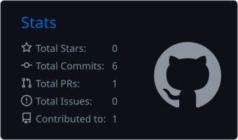
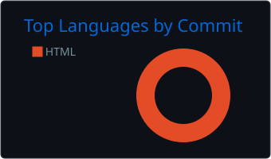

# ¡Hola! Soy Ezequiel Lencina 👋

**Marketing · Ecommerce · Desarrollo Web · Inteligencia Artificial**

Me interesa combinar tecnología, diseño y marketing para crear experiencias digitales útiles, modernas y eficientes.

Actualmente trabajo con proyectos de comercio electrónico, WordPress, WooCommerce, aplicaciones web e integraciones de APIs.

---

### 🛠️ Tecnologías y herramientas

**Frontend**

**Backend y ecommerce**

**Infraestructura y desarrollo**

### 🚀 En qué trabajo

- Desarrollo y optimización de tiendas online.
- Arquitecturas headless con WordPress, WooCommerce y Next.js.
- Integración de APIs y automatización de procesos.
- Diseño UX/UI y optimización de conversiones.
- SEO técnico y marketing digital.
- Herramientas de inteligencia artificial aplicadas al desarrollo.

### 📊 Mis estadísticas de GitHub

### 🤝 Conectemos

*Siempre aprendiendo, construyendo y mejorando.*
